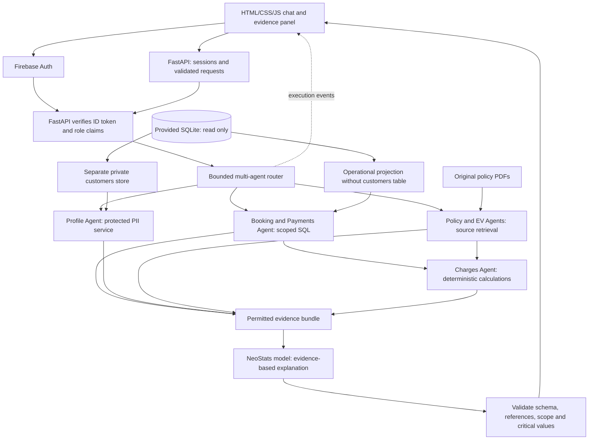

# RideWise Assist implementation plan

**Stack:** FastAPI, Python, HTML, CSS, vanilla JavaScript, SQLite, Firebase Authentication, and the event-provided LLM.

**Build budget:** 180 minutes. **Project directory:** `D:\NeoStatsH`.

This is a design plan and UI specification, not application code. The user has requested plan revisions only. Implementation must be written during the official build window. Final compliance also depends on implementation, timing, and organiser announcements. See `UI_SPECIFICATION.md` for the screen design and interaction contract.

## 1. Product goal and scope

Build a conversational rental-support assistant that retrieves permitted database facts, finds the applicable policy, performs calculations in Python, and explains the result with inspectable evidence. It serves a selected customer or a support agent. It answers questions; it does not execute cancellations, refunds, payments, or database edits.

The primary capabilities are account/KYC enquiries, booking and payment enquiries, cancellation/refund explanations, late-return and damage charges, EV guidance, and support-agent operational analytics. Questions may require records, policy text, or both.

Required user additions: separate the customers/PII access path, use Firebase for identity and RBAC, display multi-agent routing, and attach executed SQL and/or PDF evidence to every substantive answer. Use SKOPE's workspace layout with a NeoStats-inspired black/green/white visual treatment, implemented afresh. Routing progress streaming is now in scope; charts remain optional.

## 2. Sources inspected and actual pack findings

Data pack: `D:\NeoStatsH\Neostats Hackathon AI Usecase 3\Neostats Hackathon AI Usecase`.

| Source | Finding | Implementation implication |
|---|---|---|
| `ridewise.db` | 200 customers, 60 vehicles, 1,800 bookings, 3,289 payments, 80 damage reports | A small local database is sufficient; retain SQLite |
| `data_dictionary.md` | UTC timestamp strings; rupees; refunds negative; status codes and five FK-linked tables | Define explicit time, money, join, and status semantics |
| `sample_open_ai_wrapper.py` | Uses `OpenAI(base_url=..., api_key=...)` and `chat.completions.create` | Use the OpenAI SDK as a client for the NeoStats endpoint; never substitute an OpenAI-hosted or personal model |
| Five policy PDFs | Text, tables, scanned annexures, and visual EV instructions | Text extraction alone is incomplete |
| Supplemental `ridewise_data.xlsx` | Present in the supplied pack | Inspect it during the initial pack review; use the SQLite database as the operational source specified by the challenge. Do not merge it as a second set of transactions |

The database has **269 bookings with multiple successful booking-payment rows**. A single-payment assumption will give incorrect answers. Counts above are observations for planning, not application constants or expected answers to hard-code.

### Policy details already verified

1. **Version selection:** booking creation before **2026-07-01 00:00 IST** uses cancellation v1. At or after that instant uses v2. In UTC the cutoff is **2026-06-30 18:30:00**. Cancellation time and pickup time do not select the version.
2. **V1 refunds:** at least 24 hours before pickup: 100%; at least 6 but below 24 hours: 50%; below 6 hours: 0%.
3. **V2 refunds, from its scanned page-2 annexure:** at least 48 hours: 100%; at least 12 but below 48: 75%; at least 2 but below 12: 25%; below 2: 0%. The introductory prose says the full-refund window widened, but the actual signed schedule uses 48 hours. Use the approved schedule and expose that provenance.
4. RideWise cancellations receive a full refund; no-shows receive none. Refund calculations use rental charges actually paid and proportionate GST, not deposits or failed payments.
5. **Scanned tier annexure, penalty schedule page 3:** STANDARD and SILVER have no grace. GOLD has an inclusive 30-minute grace. Beyond that grace, charge the entire lateness; do not subtract 30 minutes.
6. Late fees are 1.5 times hourly rate for each begun late hour. EV returns below 10% add a Rs 150 fee. Exactly 10% does not. Applicable penalties/fees attract 18% GST.
7. Only `CHARGED` damage claims create confirmed damage charges. OPEN, DISPUTED, and WAIVED require different explanations; assessed cost alone is not a paid charge.
8. Deposits are not rental charges and have no GST. Deposit returns are handled by the gateway and are absent from these records. The assistant can explain the policy, but cannot verify a deposit return from this database.
9. EV figures include actual charging steps and battery bands. Preserve these alongside extracted text; do not discard visual-only instructions.

These are sourced business rules, not hard-coded question/answer pairs. During implementation, store their values with source page/section, policy version, and file hash in a reviewable derived rule catalogue. The original PDFs remain unchanged.

## 3. What to adapt from SKOPE

The repository and technology guide are design references. The mental-model PDF is a hypothetical practice guide; the NeoStats challenge governs the submission.

| SKOPE/reference idea | RideWise adaptation |
|---|---|
| FastAPI serves vanilla frontend | One local application and origin; no frontend build tool |
| Bounded evidence-first orchestration | Authorise, plan, gather facts/rules, calculate, explain, check |
| Structured business query plan | Model selects typed operations; application compiles permitted SQL |
| Evidence drawer | Policy excerpts, applicable version, permitted result rows, and calculation trace |
| Explicit abstention states | Different responses for unavailable model, missing facts, unclear policy, denied access, and unsupported requests |
| Progress streaming | Visible specialist routing, real execution statuses, and a validated final answer |
| Retrieval metadata | Page, section, version, applicability, extraction method, and hash |

Write fresh RideWise code. Preserve the SKOPE template's layout and interaction pattern, rather than copying its pre-event HTML/CSS/JS, handlers, prompts, query planner, indexes, or data. Avoid its Docker/Postgres/Qdrant/Redis/GPU infrastructure. Do not inherit its Gemini credentials or model choices. NeoStats' website is a visual reference only; its copy, images, and business claims are not RideWise answer sources.

## 4. Architecture



FastAPI serves the frontend files and JSON API from `127.0.0.1`. Database work and PDF extraction must not block the async event loop: extract policies at startup and run SQLite work in a worker thread with its own connection. Use one async provider client with bounded timeouts and concurrency.

### Request workflow

1. Verify the Firebase ID token and resolve its UID/claims to permitted session identity. An evaluator principal may select an evaluation role/customer; a regular customer or agent cannot self-assign new permissions through the selector or chat payload.
2. Resolve relevant conversational slots, such as the last unambiguous booking. Ask a clarification when multiple bookings or policies could apply.
3. Handle simple lookups with generic repository tools. For broader language, ask the supplied model for a validated typed plan with entity, requested fields, filters, metric/grouping, policy topic, and clarification need. Never accept raw SQL or executable expressions.
4. Validate the plan against the role-specific catalogue. Overwrite any model-supplied identity scope with the server's scope. The model cannot grant access.
5. Gather permitted facts and policy evidence. For five PDFs, start with section-aware lexical retrieval, topic aliases, and table/annexure expansion. Exact identifiers go to database lookup, not semantic document search.
6. Resolve version applicability and calculate eligible refunds/penalties using sourced rules. Distinguish hypothetical estimates from recorded transactions.
7. Supply only needed evidence to the NeoStats model for explanation. Ask for a typed response with citations and explicit uncertainty.
8. Validate evidence IDs, quoted source text, ownership, and critical money/date/identifier values. Render critical amounts from calculator outputs, rather than allowing the model to replace them.
9. Return the answer, actual executed SQL and bound parameters (sensitive values masked), PDF page/section/version references, calculation steps, and completed routing trace. Mixed answers include both SQL and PDF evidence. Never substitute an unexecuted model-generated query as proof.

### Visible multi-agent routing

Use a router and bounded domain workers sharing one authorised evidence bundle: **Profile Agent** (protected PII), **Booking/Payments Agent** (SQL lookup), **Analytics Agent** (SQL aggregates), **Policy Agent** (applicability/retrieval), **Charges Agent** (Python calculators), **EV Guide Agent** (document/figure retrieval), and **Answer/Verification** (NeoStats synthesis and local checks).

These agents are real routed modules/tools, not a separate LLM call per badge. The router chooses the applicable subset; policy/database workers can run concurrently, then calculations and explanation run in dependency order. Keep the existing zero-to-two-call budget. Emit real queued/running/completed/skipped/failed events with request ID, worker name, safe action summary, elapsed time, and evidence IDs. Show only observable actions, never hidden chain-of-thought or fabricated work. No autonomous loop, self-promotion, or model-selected endpoint changes.

Normal budget: zero model calls for deterministic failures or direct structured facts, one for policy explanations, and at most two for ambiguous planning plus explanation. No recursive agent loop or automatic second-model verification. Value/citation checks catch specific errors; they do not prove every natural-language statement is logically entailed. Document and test that limitation.

## 5. Access control and database safety

### Firebase identity and RBAC

Use Firebase Authentication for identity, with the Python Firebase Admin SDK verifying ID tokens on protected requests. Custom role claims are assigned only by a trusted admin provisioning step, not browser fields. Keep Firebase UID-to-RideWise-customer mappings in a local protected configuration/store; never map identity by an unverified submitted email. Roles: `customer`, `support_agent`, and a tightly controlled `evaluator` role.

- **Customer:** own operational records and own requested profile fields; public policies. A customer claim cannot select a different customer ID.
- **Support agent:** permitted operational lookups/analytics; scoped profile/contact access only when needed for a specific support task. No bulk PII export.
- **Evaluator:** can start a session as any existing customer ID or support agent, meeting the mandatory evaluation contract. Every worker uses the selected session's narrower effective role and customer scope; being evaluator does not broaden the model's evidence.

Prepare one Firebase evaluator identity through trusted administration. The session-start UI still contains Customer + customer ID and Support Agent. In Firebase mode this selector is enabled for the verified evaluator principal, and is not a public claim-assignment endpoint. Do not create 200 cloud identities or copy the customer table to Firebase. For the timebox, a trusted local provisioning command may issue a Firebase custom sign-in token to an evaluator; exchange it for a normal ID token through Firebase, then verify the ID token on FastAPI. No account-creation flow is required for the panel. A non-evaluator identity receives only its preassigned role/customer.

Firebase establishes identity and carries role claims; **FastAPI enforces access to SQLite and PII**. Firestore security rules do not protect a local SQLite connection. No Firestore database or Firebase hosting is required.

Keep bearer tokens in Firebase's in-memory browser persistence; send them through authenticated fetch calls, including the event stream. Do not store tokens in URLs, logs, transcripts, or browser localStorage. Verify issuer/project, expiry, signature, UID, and role claims; reject missing/invalid/revoked credentials and unknown roles. Refresh ID tokens after claim changes and check revocation/session generation for sensitive operations. Bind each application session to verified UID; reject a session ID owned by another UID.

Firebase project configuration and a backend service account are setup prerequisites. The web configuration is client-visible project configuration, not an admin credential. Keep the Admin service-account JSON and custom sign-in tokens private and ignored; point to the file with `GOOGLE_APPLICATION_CREDENTIALS`. Do not paste provided customers' emails/phone numbers into Firebase as test accounts. Use a locally mapped evaluator identity, separate from business records.

No automatic authentication bypass when Firebase fails. A deliberately configured localhost-only `evaluation_local` mode may be documented solely to preserve the official evaluation contract if organisers require it; it must be visibly labelled, disabled in Firebase/production mode, and use the identical data/PII permission checks. It is not evidence that Firebase RBAC works. Default/demo target for this plan remains Firebase, verified with a real token.

### Separate customers/PII service

The provided `ridewise.db` remains byte-for-byte unchanged, including its existing customers table. Separation happens in **derived application stores and service boundaries**:

1. A trusted loader reads the source in read-only mode. The full customers table goes to a separate **private in-memory store** owned only by `pii_service.py`; it is not attached to the general query connection.
2. Operational projections contain bookings, payments, damage reports, relevant vehicles, and a minimal `customer_attributes` projection (customer ID, tier, and KYC status). They never contain names, phone/email, DOB, licence numbers, or the raw customers table.
3. The PII service exposes narrow operations such as own-profile and specific-customer support contact lookup. It rechecks verified UID, effective role, ownership, requested fields, and task purpose. A router decision or a textual claim of purpose alone cannot grant a permission absent from the server's operation allowlist.
4. Return only required profile fields after masking by default; allow full own-field display when legitimately requested. Keep profile values out of model context where a deterministic UI/profile answer suffices. Record an audit outcome/field names, not the values.

In-memory separation is sufficient for the demo and avoids writing a new unencrypted PII file. It is an application access boundary, not OS/process-level isolation or encryption. Operational IDs, booking history, and payment data remain sensitive/linkable and require the same customer scoping even after direct PII is separated. Document these limits.

### Operational customer isolation

Trusted parameterised queries load only the selected customer's bookings, related payments and damage, relevant vehicle information, and minimal tier/KYC attributes. Customer vehicle projections exclude fleet status and commissioning information. Query workers receive this scoped projection and never the source/private database connections. Other customers' records are absent before model planning or evidence construction. Agent projections allow broader operations but exclude direct PII.

Switching effective role/customer starts a new application session; New Conversation clears history, slots, evidence, and pending UI responses while retaining the verified principal. Sign-out clears Firebase and app state. Use request/session generation IDs to reject stale results. Keep the server on loopback and enforce expected browser origins. Never make evaluator impersonation available to ordinary accounts.

### Query execution

- Open the source through SQLite URI `mode=ro`; enable `query_only` on the source connection.
- No migrations, indexes, updates, views, or writes in the supplied database.
- Compile structured plans using allowlisted identifiers/operators and bound values. Do not rely on keyword checks or appending a final `customer_id` condition to arbitrary SQL.
- The operational catalogue supports booking details, payment ledger, damage, vehicle information, and analytics: filter, sort, count, sum, average, grouping, and approved relationships. Profile/contact queries are executed exclusively through the PII service.
- Pre-aggregate payments and damage at booking grain before joining them. Avoid multiplying totals across two one-to-many joins; count distinct bookings where required.
- Set an execution deadline using a SQLite progress handler; cap result rows and label truncation. Aggregations operate over the complete authorised scope, not the capped display rows.
- Disable extension loading; reject arbitrary functions, administrative operations, filesystem access, and arbitrary query endpoints.
- Evidence, history, caches, error messages, and logs obey the same scope as answers. Do not mount the data directory as static files.

If an intent cannot be represented safely by the catalogue, clarify or state the limitation. Do not add an unsafe raw-SQL fallback just to increase coverage.

## 6. Policy ingestion and financial reasoning

### Complete policy ingestion

Extract text by page with `pypdf`, retaining headings and table relationships. Inspect each page for embedded images and meaningful text missing from extraction. The refund v2 annexure, tier annexure, and EV diagrams are mandatory ingestion work, not optional polish.

For the current tiny pack, manually review/transcribe these visual sections into a separate derived text/rule store with original filename, page/figure, extraction method, and hash. This is transparent derivation from provided data. It does not modify the originals or introduce external business data. Local OCR is an alternative if already available; verify its numbers and thresholds visually. Do not assume the supplied LLM accepts images, and do not call an outside OCR/LLM service.

Index paragraphs plus relevant tables and adjoining clauses. Retrieve the governing rule as well as exceptions, rather than splitting a percentage away from its conditions. Keep both refund versions searchable. A generic policy question should show the current rule and explain historical applicability; a booking-specific question selects by that booking's creation timestamp. A request comparing versions retrieves both.

Rebuild derived lexical indexes when source hashes change. If a scanned annexure changes, invalidate its reviewed transcription and block affected calculations until reviewed. Never silently reuse stale rules. Unknown/missing applicability or contradictory clauses produce an explicit uncertainty response with the conflicting sources.

Embeddings are an optional improvement after baseline retrieval tests pass. Use the provided embedding endpoint if supplied. If none is supplied, the challenge explicitly permits local open-source embeddings; their download and indexing must still fit the setup budget. Local generative models remain forbidden. Do not require a cross-encoder or vector database for five PDFs.

### Calculators and ledger semantics

Use timezone-aware UTC datetimes internally and explicitly labelled IST for user-facing time. Use `Decimal` for amounts and documented rounding to paise; avoid binary-float arithmetic for policy calculations. Do not infer unlisted public holidays when discussing working-day timelines.

| Calculation | Inputs and required handling |
|---|---|
| Rental estimate | Full 24-hour blocks at daily rate; remainder at hourly rate capped at one daily rate. Keep estimates distinct from the amount actually paid |
| Rental paid | Sum SUCCESS BOOKING amount/GST across instalments. Exclude FAILED/PENDING, DEPOSIT, PENALTY, and REFUND from this base |
| Refund entitlement | Resolve policy from `booked_at`; use pickup-minus-cancellation lead time, cancellation status, and successful rental payment base; refund GST proportionately |
| Refund already processed | Report recorded successful REFUND rows using their negative values; show positive magnitude when describing money returned. Keep processed refund separate from entitlement |
| Remaining estimated refund | Entitlement minus successful recorded refunds, with anomalies flagged. Do not claim the gateway has initiated/credited an unrecorded refund |
| Late return | Use actual return minus scheduled end; apply inclusive tier grace; beyond grace, round full positive lateness up to begun hours and multiply by 1.5 times hourly rate |
| EV fee | EV type + known return battery below 10% produces Rs 150 before GST; non-EV/NULL is not assumed to be 0% battery |
| Damage | Confirmed CHARGED assessed costs, with claim/report provenance; explain OPEN/DISPUTED/WAIVED distinctly |
| Penalties paid versus expected | Reconcile policy calculations with recorded SUCCESS/PENDING penalties. Do not add assessed damage and a payment for the same charge twice |
| Deposit return | Explain the policy and recorded deposit collection; explicitly state that gateway deposit returns are not available in these records |

Missing timestamps, invalid ranges, over-refunds, or conflicting values produce partial answers and warnings. An ongoing booking has no completed-return fee; any as-of estimate must be requested or clearly labelled with its reference time. Preserve the database's status facts rather than silently rewriting them from the wall clock.

## 7. API, frontend, and conversation design

### Minimal API surface

| Endpoint | Contract |
|---|---|
| `GET /` and `/static/*` | Serve only frontend assets |
| `GET /health` | Sanitised readiness: configuration, source files, policy coverage, index state. No keys, rows, full paths, or provider response dumps |
| `GET /api/config` | Public Firebase web configuration and enabled mode; no admin keys |
| `POST /api/session` | Verify Firebase principal; start allowed role/customer, with selection privileges restricted to evaluator |
| `POST /api/conversation/reset` | Clear conversation and invalidate outstanding response generation |
| `POST /api/chat` | Accept message and request ID; derive identity from session; return validated answer/evidence/state |
| `POST /api/chat/stream` | Authenticated fetch stream: actual routing/worker events and a final validated answer with SQL/PDF evidence |

Do not expose generic `/sql`, database download, unscoped history, arbitrary local-file, or administrator endpoints.

### Screen design and mandatory evidence contract

Use the SKOPE workspace template's **left sidebar + central chat + right evidence drawer**, written from scratch. Apply a near-black navigation shell, white reading surfaces, bold black headings, and NeoStats-inspired green accents/rounded controls. NeoStats' inspected primary green is `#5CB52E`; use dark text on bright green and a darker green for small text where contrast requires it. Full component/state details are in `UI_SPECIFICATION.md`.

- Start screen: Firebase sign-in/evaluator token handoff, then permitted role and customer selection; clear auth errors.
- Sidebar/header: RideWise identity, New Conversation, permitted Switch Session, policy sources, active role/customer, Firebase verification badge, and sign-out. Do not add decorative navigation to unfinished dashboards.
- Chat: keyboard submission, safe text rendering, responsive layout, reset races handled.
- Each turn: a visible routing strip/panel showing which actual specialist workers ran and their statuses. Expand for duration and safe action summary; skipped workers are labelled honestly.
- Each substantive answer: clickable **Executed SQL** and/or **PDF Sources** badges. Database-only answers include executed queries; policy-only answers include PDFs; mixed answers include both. Calculations reference their SQL inputs and governing PDF rules.
- SQL evidence: exact statement actually executed, parameter names, authorised values with sensitive values masked, source versus scoped-projection label, permitted result table, query/evidence ID, row count, duration, and truncation. Never show an entire unscoped source-loader result or unexecuted suggested SQL.
- PDF evidence: exact supplied filename, page, section/figure, policy version, quote/reviewed scan transcription, and optional allowlisted PDF page link. Attach sources used, not every retrieved candidate. Serve only public policy files via a filename allowlist, never DATA_DIR wholesale.
- PII evidence obeys field/row permissions and masks sensitive bound values; showing the executed statement must not leak another customer's existence or credentials.
- Clarifications, access denials, and infrastructure errors are control responses, not business answers. Display **No business answer generated** with an accurate source state, such as no query executed; never execute an unnecessary forbidden query or invent a citation to fill a badge.
- Follow-up chips request fresh computation/retrieval; no prerecorded business answers.

Fail final validation when a substantive answer lacks executed SQL/PDF evidence. A citation badge must open the exact evidence object for that message, scoped to the current session and verified UID. Evidence delivery has the same permissions as the original answer.

Use safe DOM text rendering for model output, database free text, and policy content; no unsanitised `innerHTML`. Treat malicious instructions embedded in remarks, descriptions, or documents as untrusted data. They cannot alter roles, tools, endpoint configuration, or permitted evidence.

Keep recent conversation turns and structured slots in server memory with bounded size/expiry. Do not reuse customer evidence between sessions. Resolve follow-ups against authorised prior entities; clarify rather than guessing when reference is ambiguous. Do not persist raw chats or sensitive context by default.

## 8. One useful step beyond the baseline

| Area | Required/essential behaviour | Extra planned behaviour | Priority |
|---|---|---|---|
| Chat | Functional chat in both roles | Visible session badge, accessible layout, stale-response protection | Include |
| Evidence | Answers can be checked | Drawer with excerpts, source versions, record rows, and formula inputs | Include |
| Customer safety | Own-data restriction | Separate PII service/store, Firebase claims, and evidence/history scope checks | Include |
| Policy correctness | Use all supplied sources | Visual-annexure coverage, version-aware retrieval, source-hash drift detection | Include |
| Calculations | Correct charges/refunds | Explain expected versus recorded amounts and anomalies | Include |
| Conversation | Context-aware interaction | Structured slots and a targeted clarification when ambiguous | Include |
| Failure handling | Cope with unavailable model/data | Specific status states, useful authorised facts, and retry guidance | Include |
| Adaptability | Handle changing business | Configurable sourced rules, schema validation, index invalidation | Include |
| Setup | Run within ten minutes | Readiness check and a minimal isolated dependency list | Include |
| Responsiveness | Loading feedback | Real multi-agent routing progress, then validated final answer | Include |
| Agent analytics | Correct tabular results | One small chart based on exactly the returned authorised aggregate | Optional after tests |

Exports, account self-registration, Docker, speech, independent model calls per specialist, custom model training, and payment/refund actions are outside the three-hour scope. Firebase identity and claim enforcement are now required user scope; minimise onboarding with an evaluator identity and keep customer business data local.

## 9. Reliability and provider contract

Use `NEOSTATS_BASE_URL`, `NEOSTATS_API_KEY`, and `NEOSTATS_MODEL` from environment variables. Optional embedding settings are separate. Require explicit values: no fallback provider/key/model, no personal account defaults. Configure only the event-provided endpoint, and validate that it is not changed through a chat request or UI parameter. Keep credentials on the server.

Start with one minimal provider connectivity check during the event. Do not assume tool calling, JSON response mode, vision, or streaming support until verified. Plain chat completions plus strict local response parsing are the baseline.

Use an overall request deadline, a small output/token budget, and bounded concurrency. Avoid stacked SDK and application retries. Respect 429 Retry-After within the deadline; at most one transient retry, no unbounded loop. After repeated failures, briefly pause new provider calls and show a retryable unavailable state. Deterministic authorised lookups and source excerpts can remain usable, but do not invent a model answer.

Response states: answered, needs clarification, no permitted record, insufficient evidence, access denied, policy needs review, provider unavailable, authentication unavailable, and verification failed. Never leak whether an inaccessible booking belongs to another customer. Log request ID, worker durations, tool/outcome, and PII access field names; avoid keys, Firebase tokens, raw questions, personal values, full rows, and provider payloads.

Cache public policy retrieval by query and source hash if useful. Do not add shared answer caching in the baseline. Any future private cache must include role, customer/session, source version, and reset generation.

## 10. Proposed project structure and dependencies

```text
D:\NeoStatsH\
  app/
    main.py             # API, lifespan, static serving
    config.py           # environment and limits
    auth.py             # Firebase ID-token verification and role dependencies
    sessions.py         # role, identity, history, reset
    models.py           # typed plans, answers, evidence
    database.py         # source read-only access and scoped projection
    pii_service.py      # separate private customers store and field permissions
    query.py            # catalogue, parameterised query compilation
    policies.py         # extraction, retrieval, applicability
    calculations.py     # sourced policy calculations and reconciliation
    assistant.py        # bounded orchestration and output validation
    router.py           # typed routing and common worker/event contract
    provider.py         # NeoStats-only client, deadlines, failure handling
  static/
    index.html
    styles.css
    app.js
  tests/
    test_access.py
    test_calculations.py
    test_conversation.py
    test_failures.py
  derived/              # ignored local indexes and reviewed transcriptions
  scripts/provision_evaluator.py  # trusted event-time Firebase provisioning
  requirements.txt
  .env.example
  .gitignore
  README.md
  DECISIONS.md
```

Keep the supplied pack separate and point to it with `DATA_DIR`, quoted because its path contains spaces. Runtime paths derive from configuration/module location, not the shell's current directory.

Minimal direct runtime dependencies: FastAPI, Uvicorn, OpenAI SDK, Pydantic, pypdf, python-dotenv, and firebase-admin. Use the version-pinned Firebase browser SDK without a Node build. Use existing httpx where needed; optional rank-bm25 only if useful. Tests use pytest. sqlite3, Decimal, and datetime are standard library components. Do not export the entire Ecothon environment as requirements; unrelated TensorFlow/GIS packages would slow setup.

During the build, validate/pin actual tested versions, including firebase-admin's compatibility with Ecothon's repaired dependencies. Include clean Python environment instructions alongside Ecothon; the developer's C: path is not an evaluator prerequisite. Target one installation step and one launch step at `http://127.0.0.1:8000`. Document Firebase project/web configuration, enabled sign-in method, UID role provisioning, private service-account placement, and evaluator sign-in. Project creation and permission setup must be ready in advance of the run rehearsal; do not require the panel to create a Firebase project. Verify the setup still fits ten minutes without Node, Docker, or large model downloads.

## 11. Three-hour execution plan

If work starts after the timer has begun, use the remaining time and cut optional extras first. Do not compress privacy/calculation verification or the final push buffer.

| Minutes | Work | Acceptance gate and commit |
|---|---|---|
| 0-15 | Read/review every pack file, including scanned pages and supplemental workbook; confirm provider interface, input integrity, and three source-backed scenarios; think through boundaries | Source manifest, one database question, one policy question, one mixed question; provider check succeeds or limitation recorded |
| 15-40 | Fresh Git project, secrets ignored, Firebase token verification/evaluator claims, FastAPI/static SKOPE-layout UI, session selection/reset | Verified evaluator can select either role; token tampering denied; skeleton committed |
| 40-75 | Separate private customers store, operational scopes, first authorised vertical slice, query catalogue, payment joins/aggregations | General SQL cannot access PII; customer isolation and split-payment totals pass; commit data tools |
| 75-105 | Policy text and visual transcriptions, section search, v1/v2 applicability, refund/late/EV/damage calculations | Mixed answer has correct version/formula and actual evidence; commit policy and calculators |
| 105-135 | NeoStats synthesis/checks, visible specialist routing stream, executed-SQL/PDF drawer, black/green/white UI, context/errors | Database-only, policy-only, analytics, and mixed answers have real routing/evidence; commit assistant |
| 135-160 | Compact critical tests in section 12; fix token/PII/isolation, calculations, reset, and provider failures | Required gates green; input hashes unchanged; commit verification fixes |
| 160-175 | README, DECISIONS, Firebase evaluator instructions, timed clean launch, secret scan, repository access | Setup fits ten minutes with provided project configuration; required files/history present; commit package |
| 175-180 | Final commit/push, verify remote HEAD and submitted repository link, actual submission form | Submit before deadline; no unpushed changes relied upon |

At minute 135 there must be an end-to-end assistant in both roles. After that, work on verification/submission rather than adding features. Chart work is removed from the scheduled budget. Firebase needs a provisioned project and private backend credentials; if setup is delayed, continue independent data/policy work and report the auth dependency, without a silent bypass. Make incremental commits and push regularly; do not fabricate/squash event history.

## 12. Compact critical acceptance checks

Run these grouped gates using supplied records and independently checked rules; use parameterised unit cases for boundaries without adding runtime business data or modifying sources.

| Gate | Must pass |
|---|---|
| Auth, roles, and PII | Invalid/expired/revoked token fails; ordinary account cannot select roles; evaluator can select both roles/any valid customer; foreign IDs reveal nothing; general SQL cannot read customers/PII; authorised profile result is scoped/masked |
| Money and policy | Split payments/GST/deposits/failure states; v1/v2 cutoff and all slab boundaries; company cancellation/no-show; GOLD 30-minute boundary/full lateness; EV 9/10/NULL; damage status; processed versus entitled refund; deposit-return uncertainty |
| Evidence and routing | Database answer has actual executed SQL; policy answer has correct PDF/page/version; mixed answer has both; scanned sections retrieved; no invented query/citation/agent execution; profile SQL parameters masked |
| Conversation and failures | Follow-up/ambiguity; reset/role change discards old response; malicious text cannot change permissions or run script; provider timeout/429/bad output fails safely; Firebase failure never silently bypasses auth |
| Reproducibility and sources | Changed policy hash invalidates stale rules; originals unchanged; README startup including prepared Firebase config fits ten minutes |

No outside judge LLM. Keep the tests focused, but do not remove these gates to save time.

## 13. Compact rule and submission gate

- **Build conduct:** individual, fresh event-time code, no participant collaboration/code sharing or copied SKOPE template code; AI coding assistance allowed, with every part explainable. Read all pack files, including visual sections. Watch organiser announcements.
- **Sources/models:** supplied data only; original database/docs unchanged; derived stores permitted; no hard-coded answers. Only NeoStats generative model/credentials; embeddings follow the explicit FAQ exception. NeoStats website is design inspiration, not answer data.
- **Access/interface:** both required evaluation role selections, specific customer ID, New Conversation any time; Firebase evaluator flow preserves these. Scope records/PII/evidence/history; expose actual SQL/PDF sources and real worker progress. No unlabelled auth bypass.
- **Secrets/setup:** .env and Firebase Admin keys/tokens ignored; blank .env.example; no credentials in browser assets/logs/Git history. Minimal requirements, DATA_DIR and Firebase setup/run instructions; timed local setup under ten minutes. Keep pack/customer data local unless organisers explicitly authorise repository redistribution.
- **Deliver:** repository source/full incremental commit history + .env.example; README with setup, environment credentials, architecture; approximately one-page DECISIONS answering the four required questions. Verify repository accessibility and actual submission URL, push final HEAD, and submit before the three-hour deadline; last pre-deadline commit is final.

The UI/PII/Firebase additions do not relax any official rule. Final compliance is verified against the built app and organiser clarifications.

## 14. Documentation and discussion preparation

README should cover minimal installation, quoted DATA_DIR, NeoStats/Firebase configuration, evaluator provisioning/sign-in and role/customer selection, launch/reset, evidence/routing, architecture, compact tests, and limitations. Include empty placeholders, not wrapper keys, Admin JSON, or evaluator tokens.

Suggested DECISIONS themes:

1. Firebase identity plus separate PII and scoped operational access before the model: clear security boundary and correct aggregations.
2. Versioned, visually complete policy retrieval plus deterministic calculators: financial correctness and provenance.
3. One FastAPI/vanilla frontend, visible bounded domain workers, and executed-query/PDF evidence: inspectable delivery with a small model-call budget.

Rejected alternatives: copying SKOPE; independent LLM calls/loops per worker; full vector infrastructure; prompt-only privacy; arbitrary model SQL; model arithmetic; broad account onboarding/cloud deployment. State limits honestly: evaluator impersonation is a controlled test capability, Firebase is a network/setup dependency, private stores share the app process, scan changes need review, catalogue coverage may be incomplete, prose is not formally proved, and deposit returns are unavailable.

One-week next steps: production UID/customer onboarding and staff permissions, independent encrypted PII storage, expanded query/privacy tests, governed policy OCR, stronger explanation validation, and measured monitoring. Preserve source and permission boundaries.

## 15. Evidence and reference links

- Governing challenge: [NeoStats use case](C:/Users/sancr/Downloads/Neostats%20Hackathon%20AI%20USECASE_1048.pdf).
- Design references: [SKOPE repository](https://github.com/sanmitra-b/SKOPE), especially its [README](https://github.com/sanmitra-b/SKOPE/blob/main/README.md), [query boundary](https://github.com/sanmitra-b/SKOPE/blob/main/backend/app/sql_tool.py), and [planning boundary](https://github.com/sanmitra-b/SKOPE/blob/main/backend/app/text_to_sql.py); [technology guide](C:/Users/sancr/Downloads/SKOPE_Technology_Guide.pdf); [practice mental model](C:/Users/sancr/Downloads/hackathon_mental_model.pdf).
- Actual pack sources: `data_dictionary.md`, read-only SQLite schema/count/ledger inspection, and the five policy PDFs in the DATA_DIR above. Visual inspection covered v2 page 2, penalties page 3, and EV pages 1-2. Wrapper inspection omitted credential values.
- Technical references: [FastAPI static files](https://fastapi.tiangolo.com/tutorial/static-files/), [Python 3.13 SQLite interface](https://docs.python.org/3.13/library/sqlite3.html), [SQLite read-only URI mode](https://www.sqlite.org/uri.html), and [MDN fetch](https://developer.mozilla.org/en-US/docs/Web/API/Fetch_API/Using_Fetch).
- New references: [NeoStats visual design](https://www.neostats.ai/), [Firebase ID-token verification](https://firebase.google.com/docs/auth/admin/verify-id-tokens), [server-assigned custom claims](https://firebase.google.com/docs/auth/admin/custom-claims), and [custom authentication](https://firebase.google.com/docs/auth/web/custom-auth). Firebase Auth is an identity service, not an alternative LLM or source of business facts.

The governing brief and supplied policy sources determine behaviour. SKOPE and the practice guide inform the architecture; their example data, model choices, performance claims, and code are not evidence for RideWise answers.
