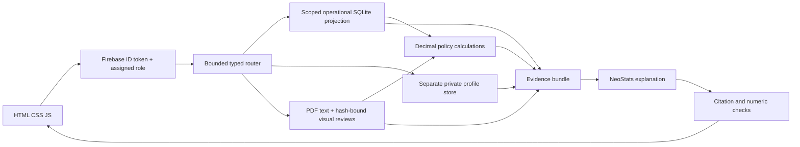

# RideWise Assist

Local read-only rental assistance using the supplied SQLite/PDF pack, the event-provided NeoStats model, and Firebase identity/role verification. FastAPI serves a fresh HTML/CSS/JavaScript workspace with live tool routing and inspectable SQL, original policy pages, and deterministic calculation evidence.

## Setup (under 10 minutes with accounts/configuration already available)

```powershell
cd D:\NeoStatsH
conda activate Ecothon
python -m pip install -r requirements.txt
Copy-Item .env.example .env
```

If `.env` already exists, preserve it. Set `RIDEWISE_DATA_DIR` to the unpacked supplied folder containing `ridewise.db`, all five PDFs and the dictionary. Set `NEOSTATS_BASE_URL`, `NEOSTATS_API_KEY`, `NEOSTATS_MODEL` to the exact values supplied by NeoStats. `python scripts/import_event_config.py` can import literal values and simple string substitutions from the supplied wrapper into blank event fields in the ignored `.env` without executing it or printing secrets. It preserves nonblank values.

Configure Firebase Authentication: register a web app, enable Email/Password if using regular accounts, add `localhost` to authorized domains, and put its public web fields in `.env`. Set `GOOGLE_APPLICATION_CREDENTIALS` to a private Admin service-account JSON path outside Git. Set `FIREBASE_PROJECT_ID`. Firebase setup is a prerequisite; no authentication bypass is enabled. No customer dataset is uploaded to Firebase or Firestore.

Assign trusted roles with the operator CLI. For regular customers, create an email/password user in Firebase first, then use its UID:

```powershell
python scripts/provision_identity.py --uid FIREBASE_UID --role customer --customer-id CUST0001
python scripts/provision_identity.py --uid STAFF_UID --role support_agent
python scripts/provision_identity.py --uid hackathon-evaluator --role evaluator --token-file secrets/evaluator-token.txt
```

The CLI changes Firebase claims and a private local UID/customer mapping. It is an administrator action, never an app endpoint. Keep the evaluator token private. Paste it in **Session & access → Evaluator access**; the browser exchanges the custom token for a Firebase ID token held only in memory. An evaluator then selects Customer + ID or Support Agent. Regular principals cannot select an elevated role or someone else's customer ID. No identity means no protected database access.

```powershell
python scripts/check_sources.py
python -m uvicorn app.main:app --host 127.0.0.1 --port 8000
```

Open http://127.0.0.1:8000 . Alternatively run `./Start-RideWise.ps1` to use Ecothon directly. New conversation clears booking context/history and invalidates late streamed answers. Stop aborts the active request. Sign out clears server session and browser identity. Source PDFs open through authenticated requests; no database/file directory is exposed. Avoid `--reload` for the final demo because it discards in-memory sessions.

## Architecture



Workers are bounded modules, not separate model instances. Visible events report real execution. Normal requests use at most two model calls: typed planning and evidence explanation. Exact booking lookups, profile queries and calculations have deterministic paths. No alternative provider/model is used during outages; the app shows source facts/excerpts or a clear unavailable state. No arbitrary model SQL runs. Typed fields/operations compile to parameterized queries with scoped in-memory data, read-only handles, query deadlines and row caps. Analytics aggregates payments before joining bookings to avoid multiplying instalments; full scoped totals are calculated before display caps. Revenue excludes GST, deposits, penalties and refunds; utilization is completed rental hours, not a capacity percentage.

The `customers` table lives only in the protected profile path. General tools see operational records plus tier/KYC attributes, never full names, phone, email, birth dates or licence numbers. Customers get only their records. Support gets operational facts and explicit one-customer profile/contact lookup; staff contact values are masked. Raw contact fields never enter a model prompt. Same-process isolation is a deliberate hackathon boundary, not an OS security sandbox.

Original pack files are read only. `scripts/check_sources.py` stores an ignored SHA-256 baseline. Reviewed scan transcriptions and policy rules are bound to source hashes; changed financial policies block calculation until reviewed. All timestamps are UTC, money is INR/Decimal. Cancellation version is chosen by booking creation, cutoff `2026-06-30 18:30:00 UTC`. The signed v2 annexure overrides vague introductory wording. A calculated entitlement is compared with successful negative refund entries; deposit gateway returns are unavailable. Open/disputed damage is not a confirmed charge.

## Verify

```powershell
python -m pytest -q
python -m pip check
python scripts/check_sources.py
```

Tests cover refund cutoffs/bands, instalments, tier grace, EV boundaries, damage status, aggregate fanout, cross-customer/role controls, query injection binding, missing authentication, UID/reset isolation, duplicate requests, authenticated stream/PDF handlers, scan provenance, changed policies and invalid generated values. Automated tests disable live provider calls and use controlled principals; they do not claim live Firebase verification. Manually test the evaluator's two roles and original PDF opening once Firebase is configured. Run an unseen general-language question once event model configuration is available.

## Submission and limits

Submit this Git repository with its complete commit history, README, DECISIONS and `.env.example`. Keep `.env`, credentials, tokens, local mapping and supplied pack out of Git. Evaluators need their supplied pack and event/Firebase configuration. The app never changes bookings or issues refunds. Register the required Firebase app before the demo; account creation/network availability cannot be guaranteed inside the 10-minute local installation budget. Commit during the event and follow organiser announcements; the application cannot establish event timing or guarantee regulatory/organiser compliance on its own.
