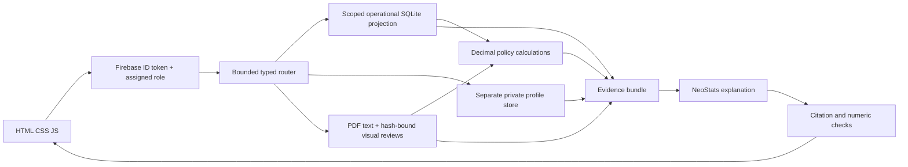

# RideWise Assist

Local read-only rental assistance using the supplied SQLite/PDF pack, the event-provided NeoStats model, and Firebase identity/role verification. FastAPI serves a fresh HTML/CSS/JavaScript workspace with live tool routing and inspectable SQL, original policy pages, and deterministic calculation evidence.

## Setup (under 10 minutes with accounts/configuration already available)

```powershell
cd D:\NeoStatsH
conda activate Ecothon
python -m pip install -r requirements.txt
Copy-Item .env.example .env
```

If `.env` already exists, preserve it. Set `RIDEWISE_DATA_DIR` to the unpacked supplied folder containing `ridewise.db`, all five PDFs and the dictionary. Set `NEOSTATS_BASE_URL`, `NEOSTATS_API_KEY`, `NEOSTATS_MODEL` to the exact values supplied by NeoStats. `python scripts/import_event_config.py` can import literal values and simple string substitutions from the supplied wrapper into blank event fields in the ignored `.env` without executing it or printing secrets. It preserves nonblank values.

Configure Firebase Authentication: register a web app, enable Email/Password if using regular accounts, add `localhost` to authorized domains, and put its public web fields in `.env`. Set `GOOGLE_APPLICATION_CREDENTIALS` to a private Admin service-account JSON path outside Git. Set `FIREBASE_PROJECT_ID`. Firebase setup is a prerequisite; no authentication bypass is enabled. No customer dataset is uploaded to Firebase or Firestore.

The app includes **Sign in**, **Create account**, **Continue with Google**, and password reset. Email/password credentials are chosen by the user during sign-up; regular customers have no default password. The administrator provisions the evaluator account separately; its password is never stored in this repository. Enable Google under Firebase Authentication → Sign-in method → Google and choose the project support email. Google sign-in creates an account on its first successful use. Both email and Google registrations receive Customer through the authenticated backend bootstrap; the browser cannot submit a role or customer ID. Existing staff/evaluator assignments are preserved.

Use Chrome or Edge for the Google popup and allow popups for the local app. The in-app browser's Google flow timed out during verification; a completed Google account sign-in is not claimed. Email sign-up uses the Firebase SDK directly. Customer passwords are entered through Firebase; the evaluator password was configured separately by the administrator and is never recorded in this repository. `python scripts/check_signup.py` verifies default Customer assignment and blocked self-elevation with a disposable Firebase identity, then removes only that test identity.

New Customers initially get **policy access**. Their sign-in is not automatically matched to supplied customer emails or an arbitrary chosen ID. An administrator must verify ownership and link the UID to an existing RideWise customer record. Personal-record tools deny access until linked; the provided database remains unchanged. The UID is shown in Session & access and Firebase Console → Authentication → Users.

Assign trusted roles with the operator CLI. Use the existing user's UID from Firebase Authentication:

```powershell
python scripts/provision_identity.py --uid FIREBASE_UID --role customer --customer-id CUST0001
python scripts/provision_identity.py --uid STAFF_UID --role support_agent
python scripts/provision_identity.py --uid hackathon-evaluator --role evaluator
```

The CLI uses the Firebase Admin SDK to set the `role` custom claim and maintains the private local UID/customer mapping. Firebase Console's Users screen does not directly assign these application roles. To make a support executive, run the `--role support_agent` command from this trusted backend machine; then have the user sign out and sign back in to refresh claims. There is no public support-role selector or promotion endpoint. Keep Admin credentials private. Regular users automatically enter their assigned session; only the evaluator selects a narrower role.

For evaluator access, use the normal email/password Sign in form with the administrator-provided credentials. The evaluator can select Customer + ID or Support Agent. Regular principals cannot select an elevated role or another customer ID. There is no custom-token login field or token-generation option. Firebase refreshes the active session automatically; reloading clears its in-memory identity. Backend verification permits 30 seconds of laptop clock drift while retaining signature, audience and revocation checks.

`python scripts/check_firebase.py` prompts for the evaluator email and hidden password, verifies its Firebase role, checks both narrowed sessions, cross-customer denial, authenticated streaming and original PDF access. It prints only check results and does not consume model quota.

```powershell
python scripts/check_sources.py
python -m uvicorn app.main:app --host 127.0.0.1 --port 8000
```

Open http://127.0.0.1:8000 . Alternatively run `./Start-RideWise.ps1` to use Ecothon directly. New conversation clears booking context/history and invalidates late streamed answers. Stop aborts the active request. Sign out clears server session and browser identity. Source PDFs open through authenticated requests; no database/file directory is exposed. Avoid `--reload` for the final demo because it discards in-memory sessions.

## Architecture



Workers are bounded modules, not separate model instances. Visible events report real execution. Normal requests use at most two model calls: typed planning and evidence explanation. Exact booking lookups, profile queries and calculations have deterministic paths. No alternative generative provider/model is used during outages; the app shows source facts/excerpts or a clear unavailable state. No arbitrary model SQL runs. Typed fields/operations compile to parameterized queries with scoped in-memory data, read-only handles, query deadlines and row caps. Analytics aggregates payments before joining bookings to avoid multiplying instalments; full scoped totals are calculated before display caps. Revenue excludes GST, deposits, penalties and refunds; utilization is completed rental hours, not a capacity percentage.

The `customers` table lives only in the protected profile path. General tools see operational records plus tier/KYC attributes, never full names, phone, email, birth dates or licence numbers. Customers get only their records. Support gets operational facts and explicit one-customer profile/contact lookup; staff contact values are masked. Raw contact fields never enter a model prompt. Same-process isolation is a deliberate hackathon boundary, not an OS security sandbox.

Original pack files are read only. `scripts/check_sources.py` stores an ignored SHA-256 baseline. Reviewed scan transcriptions and policy rules are bound to source hashes; changed financial policies block calculation until reviewed. All timestamps are UTC, money is INR/Decimal. Cancellation version is chosen by booking creation, cutoff `2026-06-30 18:30:00 UTC`. The signed v2 annexure overrides vague introductory wording. A calculated entitlement is compared with successful negative refund entries; deposit gateway returns are unavailable. Open/disputed damage is not a confirmed charge.

## Verify

```powershell
python -m pytest -q
python -m pip check
python scripts/check_sources.py
```

Tests cover refund cutoffs/bands, instalments, tier grace, EV boundaries, damage status, aggregate fanout, cross-customer/role controls, query injection binding, missing authentication, UID/reset isolation, duplicate requests, authenticated stream/PDF handlers, scan provenance, changed policies and invalid generated values. Automated tests disable live provider calls and use controlled principals; they do not claim live Firebase verification. Manually test the evaluator's two roles and original PDF opening once Firebase is configured. Run an unseen general-language question once event model configuration is available.

## Submission and limits

Submit this Git repository with its complete commit history, README, DECISIONS and `.env.example`. Keep `.env`, credentials, tokens, local mapping and supplied pack out of Git. Evaluators need their supplied pack and event/Firebase configuration. The app never changes bookings or issues refunds. Register the required Firebase app before the demo; account creation/network availability cannot be guaranteed inside the 10-minute local installation budget. Commit during the event and follow organiser announcements; the application cannot establish event timing or guarantee regulatory/organiser compliance on its own.

Saved conversation history is stored separately in ignored `derived/chat_history.db`, never in the supplied `ridewise.db` or Firebase/Firestore. Access requires a verified Firebase UID and the current permitted role/customer scope. New conversation preserves the earlier chat; reopening restores the original scope, booking context, answers, SQL/PDF/formula evidence and routing events. History is available in the sidebar and the History button on smaller screens. Sign-out clears browser content while saved history remains on this backend computer. Users can delete their saved conversations. History survives backend restarts; retain the private derived database when moving the app. Existing conversations from before this feature cannot be recovered. Conversations are not automatically shared across separate backend installations.


## Semantic policy RAG

Policy retrieval uses persistent **Qdrant local mode** and **FastEmbed BAAI/bge-small-en-v1.5**, a 384-dimensional CPU embedding model. Policy text and reviewed visual transcriptions are split within each page into 220-word passages with 40-word overlap. The question is embedded and Qdrant ranks the top eight passages using cosine similarity, filtered by permitted policy topic. Passages are grouped back into original PDF-page citations. Related reviewed annexures supplement the semantic hits; refund calculations still select the correct policy version deterministically by booking creation time.

The current pack produces 17 passages from 11 pages. Only supplied policy content is embedded: no customer records, PII or chat history enter Qdrant. The vector store is ignored `derived/qdrant/`; downloaded model files are ignored `derived/embedding_models/`. Source hashes, passage content, model and index schema determine the collection fingerprint, so changed documents cannot reuse a stale index. Complete indexes are reused across restarts. Local mode supports one backend process; launch without multiple Uvicorn workers or a separate concurrent index builder.

The brief's embedding FAQ allows an open-source local embedding model when no event embedding model is supplied. If NeoStats supplies one, set `NEOSTATS_EMBEDDING_MODEL` to its exact name; embeddings then use the same provided HTTPS endpoint/key. A configured event embedding failure does not fall back to a different provider or local model. Generative answers always use the supplied NeoStats model.

After installing requirements, prepare the model and index before the demo:

```powershell
python scripts/build_policy_index.py
```

Run this with the app stopped. First use requires internet for the model download; subsequent local inference uses cached files. Automatic startup also prepares the index. On this laptop the model download/warmup took about 11 seconds and indexing about 3 seconds; other machines and connections may differ. If embedding setup fails, database lookups and deterministic calculations remain usable, and semantic policy questions report an explicit unavailable state. `/health` exposes `semantic_ready`. PDF evidence displays the embedding model, cosine similarity and passage IDs; similarity is a retrieval ranking, not an answer-confidence percentage. The reviewed-annexure supplements are labelled separately. No keyword retrieval is silently substituted.
