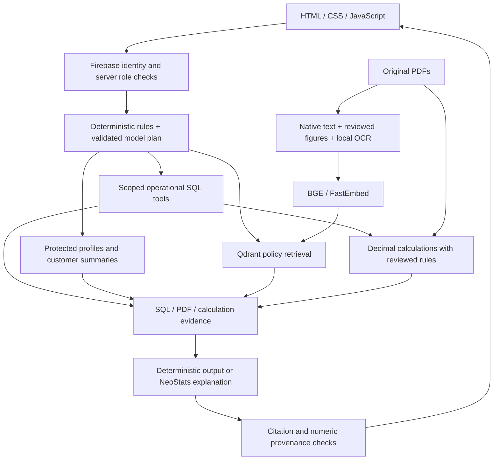

# RideWise Assist

RideWise Assist is a read-only rental support application built for the NeoStats AI Hackathon. Customers can ask about their bookings, payments and policies; support staff can investigate operational records and view dashboards. Answers include the executed SQL, the original PDF pages used, or calculation evidence so that the result can be checked.

The application uses **FastAPI, HTML/CSS/JavaScript, SQLite, Firebase Authentication, local Qdrant semantic retrieval and the NeoStats-provided generative model**. It preserves the supplied database and PDFs.

## What is implemented

| Area | Behavior |
|---|---|
| Customer access | Own bookings only, with Upcoming, Ongoing, Past and Cancelled cards; expandable payments, refunds and damage reports |
| Support access | Customers, Hubs & Vehicles, Bookings & Payments and Damage Reports dashboards, with server-enforced role checks |
| Chat | Hybrid routing, visible worker progress, streamed results, role-specific suggested prompts and follow-up booking context |
| Policies | Dedicated library linking to the five original authenticated PDFs |
| Semantic RAG | Qdrant + local BGE embeddings; OCR for image content in PDFs 3, 4 and 5; original page citations |
| Money | Deterministic Decimal calculations for implemented refund, late-return, battery, damage and rental rules |
| Evidence | SQL plus bound parameters, PDF filename/page/version/hash, and calculation inputs/formulas |
| History | User-scoped saved conversations, reopen/delete, and protection against stale responses after reset |
| Identity | Email/password sign-in, customer sign-up, Google sign-in and password reset through Firebase |
| City aliases | Bangalore, Bengaluru and BLR resolve to Bengaluru in customer summaries and residence-city filters |

The layout takes inspiration from SKOPE, with a black, green and white visual direction inspired by NeoStats. The application code was written for this project.

## Run locally

The tested environment is Windows with Python 3.13.9 in the `Ecothon` Conda environment. Docker is not required. A fresh environment can be created as follows; skip creation if Ecothon already exists.

```powershell
git clone https://github.com/sanmitra-b/NeoStats-RideWise.git
cd NeoStats-RideWise
conda create -n Ecothon python=3.13 -y
conda activate Ecothon
python -m pip install -r requirements.txt
```

Create the local configuration without overwriting an existing file:

```powershell
if (-not (Test-Path -LiteralPath .env)) { Copy-Item .env.example .env }
```

Edit `.env` for this machine. The example contains the original developer's `D:/NeoStatsH` paths; replace them if your checkout or source pack is elsewhere.

| Variable | Value to supply |
|---|---|
| `RIDEWISE_DATA_DIR` | Folder containing the original `ridewise.db`, five policy PDFs and data dictionary |
| `NEOSTATS_BASE_URL`, `NEOSTATS_API_KEY`, `NEOSTATS_MODEL` | Exact event-provided endpoint, key and model |
| `FIREBASE_PROJECT_ID`, `FIREBASE_WEB_API_KEY`, `FIREBASE_AUTH_DOMAIN`, `FIREBASE_APP_ID` | Registered Firebase web app configuration |
| `GOOGLE_APPLICATION_CREDENTIALS` | Absolute path to a private Firebase Admin service-account JSON |
| `CUSTOMER_MAPPING_FILE` | Private UID/customer mapping path; use this checkout's `secrets/customer_mapping.json` |
| `NEOSTATS_EMBEDDING_MODEL` | Leave blank for the local embedding setup, unless NeoStats supplies an embedding model |

The supplied policy filenames must remain:

```text
01_Rental_Agreement_and_Terms.pdf
02_Cancellation_and_Refund_Policy_v1.pdf
03_Cancellation_and_Refund_Policy_v2.pdf
04_Late_Return_and_Damage_Penalty_Schedule.pdf
05_EV_User_Guide_and_FAQ.pdf
```

Keep the provided pack and credentials outside the tracked repository. The data is not bundled in this submission. `scripts/import_event_config.py` can import event settings from the supplied wrapper into blank `.env` fields without executing the wrapper or printing its secrets; existing nonblank values are preserved.

Configure Firebase as described below, then prepare the sources and index with the app stopped:

```powershell
python scripts/check_sources.py
python scripts/build_policy_index.py
python -m uvicorn app.main:app --host 127.0.0.1 --port 8000
```

Open [http://127.0.0.1:8000](http://127.0.0.1:8000). `Start-RideWise.ps1` is an optional shortcut for the original Windows installation; it tries the original Ecothon Python path and otherwise uses `python`.

First embedding use needs internet to download the model. OCR models run locally, and successful OCR, embeddings and vectors are cached under ignored `derived/` folders. On the development laptop, the first OCR/index build took about 50 seconds; a cached rebuild took about four seconds. These are observations, not installation-time guarantees.

Run one backend process. Do not use multiple Uvicorn workers or run the index builder concurrently against the same local Qdrant store. Avoid `--reload` during the demo because restarts discard active sessions.

## Firebase setup and roles

Register a Firebase web app, enable Email/Password and Google as required, choose the Google provider support email, and add `localhost` and any other development hostnames you use to authorized domains. Keep the Admin JSON private. The browser uses the public web configuration; the server uses Admin credentials to verify identity and trusted custom claims.

New email or Google accounts receive **Customer** through the authenticated backend bootstrap. There is no public role-promotion endpoint. Registration does not create or modify supplied customer records. New accounts initially have policy access until an administrator verifies ownership and links their UID to an existing customer.

Use the UID from Firebase Authentication → Users. On the trusted backend machine:

```powershell
python scripts/provision_identity.py --uid CUSTOMER_UID --role customer --customer-id CUST0001
python scripts/provision_identity.py --uid STAFF_UID --role support_agent
python scripts/provision_identity.py --uid EVALUATOR_UID --role evaluator
```

These commands assign the `role` Firebase custom claim and maintain the private local customer mapping. The Firebase Users screen does not directly assign this application's roles. Sign out and back in after role or mapping changes.

Regular users enter their assigned role. The evaluator can select a narrower Customer session with an existing customer ID or a Support Agent session. Even an evaluator in Customer mode cannot call support dashboard endpoints. Evaluator sign-in uses administrator-provided email/password credentials; no passwords, bearer tokens or Admin keys are included in the repository. There is no custom-token login field.

Use Chrome or Edge and allow popups for Google sign-in. Successful end-to-end Google sign-in was not verified in the in-app browser. Firebase and event-provider connectivity must be tested on the evaluator's machine; local configuration flags alone do not establish external connectivity.

## Suggested demo

1. Sign in as the evaluator and start a Customer session linked to a supplied customer ID. Show My Bookings and expand a booking's payments and claims.
2. Ask `Show my bookings`, then ask about the refund or charges for a booking returned by the data. Inspect SQL, policy pages and calculation evidence.
3. Ask `How do I charge an EV?` and open the original cited PDF. Explain that figure text is included through OCR and reviewed transcriptions.
4. Start a Support Agent session. Ask `List customer count by tier`; this counts customer rows, not booking rows. Ask `Count bookings by hub` to show booking analytics.
5. Open the dashboards. The Bengaluru filter combines Bangalore, BLR and Bengaluru variants without changing the source database.
6. Start a New conversation to show role-specific prompts. Reopen a saved conversation to demonstrate user-scoped history and retained evidence.

Use actual IDs from displayed records for booking-specific questions. A request without an applicable booking or supported filter may ask for clarification. The app never executes a cancellation or transfers money.

## Architecture and safeguards



The workers are bounded modules, not independent autonomous model instances. Visible routing events describe actual execution. Recognizable requests use local rules; other questions use the supplied model to select a typed operation. The model never supplies arbitrary SQL for execution. SQL is compiled from code-owned templates with parameter binding, scope checks, deadlines and row caps.

The supplied SQLite file is opened read-only and immutable. General chat tools use a scoped in-memory operational projection, with only customer ID, tier, KYC and canonical residence city as customer attributes. Full customer records stay in the protected private path. Support-directory names are masked, and phone, email, birth date and licence number are excluded. Contact lookups require one customer; private contact fields do not enter model prompts. This is same-process separation, not a separate PII security service.

Customer counts have their own support-only operation, grouped by tier, KYC or city. Booking analytics aggregate payment rows before joining to prevent inflated counts. Revenue means successful BOOKING base excluding GST, deposits, refunds and penalties. Utilization means completed rental hours rather than a capacity percentage.

Only the supplied NeoStats generative endpoint is used. An outage does not trigger another provider. Direct facts and implemented calculations can still be returned; semantic-search failure is explicit. Generated claims are checked for known citations and numeric provenance, with source facts/excerpts used if validation fails. This is not a proof of semantic correctness.

## RAG and OCR settings

| Setting | Implementation |
|---|---|
| Embedding model | `BAAI/bge-small-en-v1.5`, FastEmbed, 384 dimensions, ONNX CPU |
| Chunking | Up to 220 whitespace-delimited words, 40-word overlap, confined to a page/extraction segment |
| Retrieval | Top eight chunks by cosine similarity, filtered by policy topic |
| Current corpus | 28 passages from 11 original PDF pages |
| OCR | RapidOCR + PyMuPDF at 240 DPI on all seven pages of PDFs 3, 4 and 5 |
| Citations | Original filename, page, version, hash and extraction method |
| Caching | OCR keyed by source/page/DPI/engine versions; vectors fingerprinted by content, sources and embedding configuration |

Native/reviewed passages and OCR passages are chunked separately. Related reviewed annexures supplement retrieval. OCR can misread numbers or table relationships, so hash-reviewed financial transcriptions remain authoritative. OCR recognition confidence is not answer confidence; cosine similarity is not factual confidence. Customer records and conversations are never embedded into Qdrant.

The briefing's embedding FAQ permits a local open-source embedding model when no event model is supplied. If an event embedding model is configured, the app uses the supplied endpoint and does not silently fall back to local embeddings on failure. Financial calculations select the applicable policy deterministically rather than relying on the nearest vector match.

## Financial interpretation and time

Calculations use Decimal and separate base amounts, GST, deposits, assessed charges and recorded payments. Refund policy version depends on booking creation, with the v2 cutoff at `2026-06-30 18:30:00 UTC` (1 July 2026 midnight IST). The reviewed signed schedule governs refund bands. Gold grace is inclusive at 30 minutes; beyond grace, full lateness is charged in begun hours. Exactly 10% battery does not attract the below-10% fee. Only CHARGED damage is counted as a confirmed damage charge.

Refund entries are negative in the supplied records. Calculated entitlement is compared with successful recorded refunds, not treated as proof of gateway settlement. Deposit gateway returns are absent from this dataset. Rental results are scheduled estimates, not evidence that payment occurred. Source-hash changes block affected financial calculations pending review.

Stored timestamps are UTC. Booking cards and dashboard timestamps display IST. Dashboard date filters apply to scheduled pickup over the selected IST days. Raw SQL evidence can retain UTC and labels it accordingly. Chat monthly analytics currently group by the stored UTC month. City filters refer to customer residence, not a vehicle hub.

## History and interface behavior

Saved conversations are stored in ignored `derived/chat_history.db`, separately from the source database. Reads, reopening and deletion are restricted by Firebase UID and current access. Saved answers retain SQL/PDF/formula evidence and worker events. No customer dataset or history is uploaded to Firestore.

New conversation resets active context while preserving earlier saved chats and restoring suggested prompts. Stop aborts an active request. Reset generations prevent late responses from appearing in a new conversation. Sign-out clears visible identity and content. History survives restarts on this backend computer; active sessions do not. Browser identity uses in-memory Firebase persistence, so reload requires signing in again. The top Session button controls access; the duplicate sidebar control was removed.

The Formula evidence tab explains implemented financial calculations; ordinary record and policy answers may have no calculation evidence. It does not execute payments or modify data.

## Verification

The latest regression run passed **84 tests**. Coverage includes ownership and role enforcement, the customer-count routing fix, city aliases, query binding, aggregation fanout, refund boundaries, grace/battery rules, policy hashes, semantic paraphrases, real OCR ingestion, cache invalidation, history isolation and stale-response protection.

```powershell
python -m pytest -q
python -m pip check
python scripts/check_sources.py
```

Automated tests disable live generative calls and isolate history/vector stores. They do not prove live Firebase or event-provider connectivity. JavaScript syntax has also been checked; original source hashes match the baseline.

Useful optional live checks:

```powershell
python scripts/check_firebase.py
python scripts/check_signup.py
```

`check_firebase.py` prompts for evaluator credentials and checks authentication, scope and protected handlers without consuming model quota. `check_signup.py` creates a disposable Firebase test identity, checks default Customer assignment and blocked self-elevation, then removes that identity. These are optional administrative checks, not prerequisites for ordinary app use.

The [health endpoint](http://127.0.0.1:8000/health) exposes source/configuration readiness, `ocr_ready` and `semantic_ready`. Check both OCR and semantic readiness before the demo. OCR status confirms extraction returned text, not that every visual region was interpreted correctly.

## Limitations and submission contents

The bounded query catalogue cannot answer every unseen analytical request. There is no reranker, similarity cutoff, token-aware/table-aware chunk splitter or formal claim-entailment validator. OCR can misread scans and cannot infer unlabeled graphical meaning. The current tests cover selected cases rather than every possible question.

This is a single-backend local deployment. Sessions are in memory, history is not synchronized across installations, and there is no production audit/retention system or separate PII service. Firebase/provider setup, connectivity and model download time are external dependencies. The app cannot verify real payment settlement or holiday-aware refund processing from the supplied data.

The GitHub submission contains source code, dependency pins, `.env.example`, setup scripts, tests, this README, [DECISIONS.md](DECISIONS.md), [IMPLEMENTATION_PLAN.md](IMPLEMENTATION_PLAN.md) and [UI_SPECIFICATION.md](UI_SPECIFICATION.md), with the implementation commit history. DECISIONS.md describes current choices and limitations in detail; older planning proposals should not be treated as delivered functionality.

`.env`, service-account credentials, passwords/tokens, private UID mappings, supplied datasets/PDFs, conversation stores and cached models/vectors are excluded from Git. Evaluators must provide the authorized source pack and configuration. Publishing the repository does not complete any separate organiser submission form; submit the repository link through the event's required channel.
